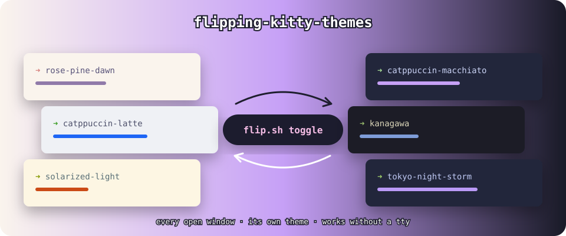

<div align="center">



# flipping-kitty-themes

**Switch every open kitty window to light or dark, each with its own theme, with one command. It also works
from an AI agent's shell, which has no terminal attached.**


</div>

---

A companion to [**kitty-but-like-iterm**](https://github.com/atharva-2001/kitty-but-like-iterm).
That config gives each *new* window a random theme, and re-rolls every window when macOS switches
between light and dark. This tool covers the rest: **"make all my terminals light right now"** without
changing the system appearance.

```sh
flip.sh light     # every open window → a random light theme
flip.sh dark      # every open window → a random dark theme
flip.sh toggle    # the opposite of the last flip
```

Every window gets its own theme, and its tab is tinted to match. The script prints one line per window,
then `done`, then any errors under `--- errors:`. No errors block means it worked.

## Why this exists

Running `kitten @ set-colors` from a normal terminal works. From an AI agent's Bash tool (Claude Code,
Codex, and others) it fails:

```text
Error: open /dev/tty: device not configured
```

The agent's shell has no controlling terminal, and kitty isn't listening on a socket. `flip.sh` works
around this:

```text
agent shell (no tty)
   │ 1. walk up the process tree to the nearest ancestor with a kitty tty
   │ 2. run `kitten @ launch …` inside `script` (a fake pty) and capture the escape sequence it prints
   │ 3. set "no_response": true, so kitty's reply doesn't arrive as typed keystrokes
   │ 4. write that sequence to the kitty tty
   ▼
kitty starts flip.sh --relight in the background, with remote control allowed
   │ 5. `kitten @ ls` → real window ids → set-colors + set-tab-color for each one
   ▼
~/.cache/kitty-flip/log.txt   ← read back and printed
```

## Install

### As a Claude Code skill

```sh
git clone https://github.com/atharva-2001/flipping-kitty-themes ~/.claude/skills/flipping-kitty-themes
```

Then ask Claude *"make my terminals light"* or *"flip kitty themes"*. [`SKILL.md`](SKILL.md) tells it when to
use the skill and how.

### As a plain script

Clone it anywhere and run `./flip.sh light` from a shell that kitty started (directly, or through an agent
running inside a kitty window). It won't work from Terminal.app or another terminal.

> [!TIP]
> **Let your agent set it up.** Paste this into your coding agent:
>
> ```text
> Set up https://github.com/atharva-2001/flipping-kitty-themes for me by following
> AGENT_INSTALL.md in that repo. Don't overwrite or delete anything; ask me first if a
> step conflicts with what I already have.
> ```
>
> The steps the agent follows are in [`AGENT_INSTALL.md`](AGENT_INSTALL.md).

## Requirements

| Needs | Why |
|---|---|
| macOS + kitty at `/Applications/kitty.app` | `flip.sh` calls kitty's bundled `kitten` |
| `allow_remote_control yes` in `kitty.conf` | The background helper uses remote control |
| Themes in `~/.config/kitty/themes/` named `light-*.conf` / `dark-*.conf` | The pool it picks from ([kitty-but-like-iterm](https://github.com/atharva-2001/kitty-but-like-iterm) ships 26) |
| Run from inside kitty | It finds kitty through the nearest parent process that has a kitty tty |
| `python3` | Captures and rewrites the escape sequence |
| `timeout` | Not on stock macOS: `brew install coreutils` |

## Troubleshooting

| You see | Fix |
|---|---|
| `no kitty tty found among ancestors` | It isn't running under kitty. Run it from a kitty window, or from an agent started in one. |
| `no log — helper did not run` | `allow_remote_control` is off, or kitty hasn't been restarted since you turned it on |
| `could not capture kitten escape` | `timeout` or `kitten` is missing from `PATH` |
| One window still looks wrong | The program in it (vim, a TUI) draws its own background |

**Simpler permanent fix:** add `listen_on unix:/tmp/kitty` to `kitty.conf` and restart kitty once.
After that, `kitten @ --to unix:/tmp/kitty-<pid> …` works from any shell and you don't need this trick.

> [!WARNING]
> `allow_remote_control yes` lets any program running inside kitty control kitty. That's the trade-off this
> tool depends on. Know that before you turn it on.

## License

[MIT](LICENSE)
